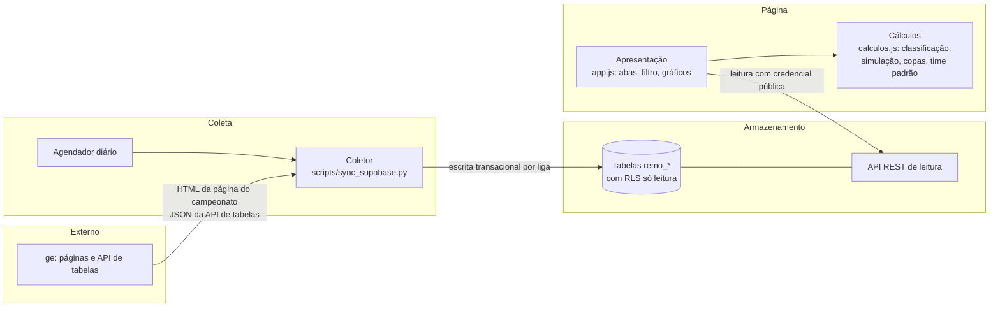
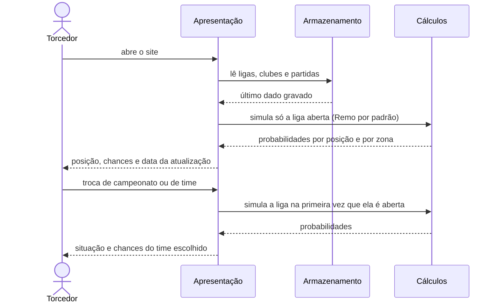

# View computational

Componentes, interfaces e interações. Atende `CON-situacao`, `CON-chances`,
`CON-facilidade` e `CON-confiabilidade`.

## Modelo estático (componentes)



| Componente | Responsabilidade | Requisitos |
|---|---|---|
| Agendador | dispara a coleta uma vez por dia e avisa falha ao mantenedor | `RF-coletar`, `RF-avisar-falha`, `QS-atualidade` |
| Coletor | descobre a edição atual, baixa todas as fases, isola falhas por liga | `RF-coletar`, `RF-edicao-atual`, `RF-preservar` |
| Armazenamento | guarda o último dado válido; leitura pública, escrita só do coletor | `QS-tolerancia-fonte`, `QS-somente-leitura` |
| Apresentação | abas por campeonato, filtro de time, gráficos, data da atualização; no celular, fontes maiores, menos colunas e siglas (`docs/especificacao/interface-celular.md`) | `RF-escolher-time`, `RF-data-atualizacao`, `QS-facilidade`, `QS-legibilidade`, `QS-tabela-celular` |
| Cálculos | funções puras, sem DOM nem rede; testáveis em Node | `RF-classificacao`, `RF-simular`, `RF-chances-zona`, `RF-campanha-copa`, `QS-desempenho` |

`calculos.js` é novo (decisão `AD-modulo-calculos`). Hoje essas funções estão
dentro de `app.js`.

## Modelo dinâmico

### Atualização diária

```mermaid
sequenceDiagram
  participant AG as Agendador
  participant COL as Coletor
  participant GE as ge
  participant BD as Armazenamento
  AG->>COL: 00:00 em Belém
  COL->>BD: aplica schema.sql (idempotente)
  loop cada liga
    COL->>GE: página do campeonato
    GE-->>COL: UUID da edição (ou falha: usa o reserva)
    COL->>GE: classificação e jogos de todas as fases
    alt dados com jogos
      COL->>BD: transação: substitui liga, clubes e partidas
    else falha ou sem jogos
      COL->>COL: registra a falha e mantém o dado anterior
    end
  end
  alt alguma liga falhou
    COL-->>AG: termina com código diferente de zero
    AG-->>AG: execução marcada como falha; GitHub avisa o mantenedor
  else todas ok
    COL-->>AG: termina com sucesso
  end
```

### Consulta das chances


