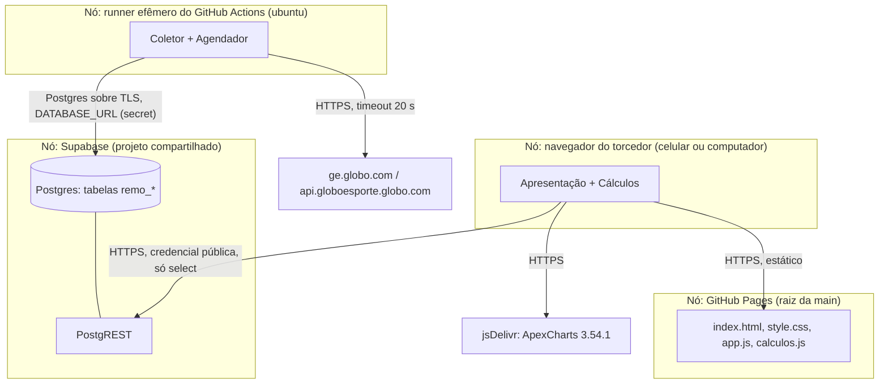

# View engineering

Como as funções da view computational são distribuídas em nós, canais e
políticas. Atende `CON-confiabilidade` e `CON-manutencao`.

## Modelo de implantação

## Canais e políticas

| Canal | Política | Origem |
|---|---|---|
| Runner → ge | requisição com timeout de 20 s; falha de uma liga não interrompe as outras | `AD-isolamento-por-liga` |
| Runner → Postgres | uma transação por liga; credencial só no secret `DATABASE_URL` | `AD-isolamento-por-liga`, `RNF-sem-segredos` |
| Navegador → PostgREST | credencial publishable; RLS libera só `select` | `AD-rls-somente-leitura` |
| Navegador → Pages | arquivos estáticos; `?v=` no `index.html` invalida o cache | `AD-estatico-sem-servidor` |
| Agendador → mantenedor | execução com falha gera o e-mail padrão do GitHub Actions | `AD-aviso-por-falha` |

## Alocação de carga

- A simulação roda no nó mais fraco (o celular do torcedor). Por isso é feita só
  para a liga aberta e com estruturas leves (`AD-simulacao-sob-demanda`).
- O ge só é acessado pelo runner, uma vez por dia. O torcedor nunca depende do ge
  em tempo real (`AD-coleta-agendada`).
