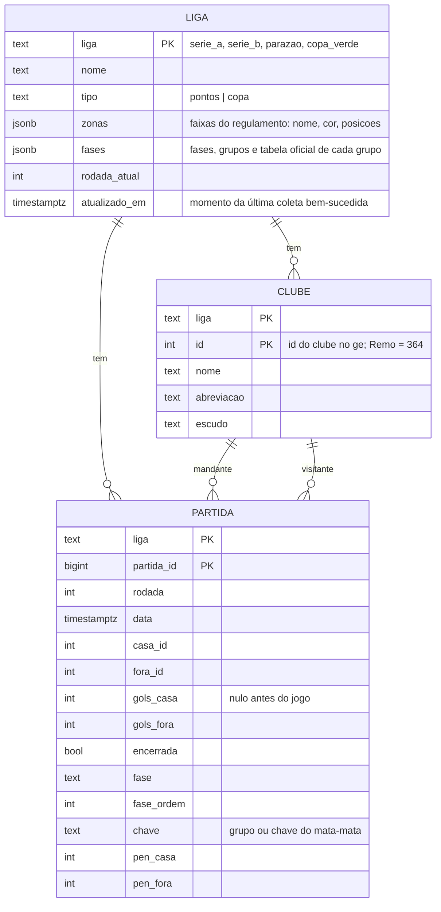
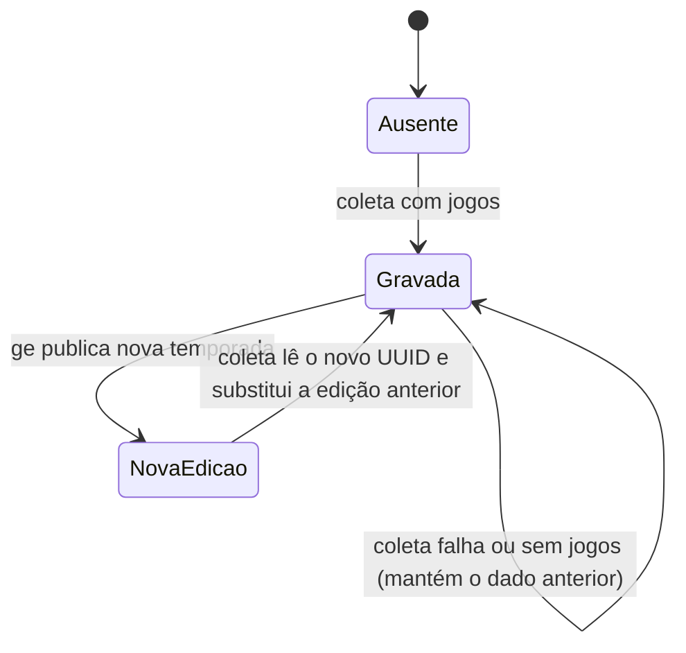

# View information

Quais dados existem, como se relacionam e como mudam. Atende `CON-situacao`,
`CON-chances` e `CON-confiabilidade`. Recuperada do código (`supabase/schema.sql`,
`scripts/sync_supabase.py`, `app.js`) em 2026-10-31.

## Modelo estático

Dados derivados, calculados no navegador e nunca gravados:

| Dado | Origem | Requisito |
|---|---|---|
| Classificação (PTS, J, V, E, D, GP, GC) | partidas encerradas | `RF-classificacao` |
| Probabilidade de cada posição final por clube | simulação dos jogos restantes | `RF-simular` |
| Probabilidade por zona | soma das posições de cada zona | `RF-chances-zona` |
| Vencedor da chave, campanha, campeão | partidas do mata-mata | `RF-campanha-copa` |

Invariantes:

- As partidas, os clubes e a liga são sempre regravados juntos (uma transação por liga).
- Nas ligas `pontos`, só as partidas da primeira fase entram na simulação.
- As probabilidades de posição de um clube somam 1, e cada posição soma 1 entre os clubes.

## Modelo dinâmico (ciclo de vida dos dados de uma liga)

